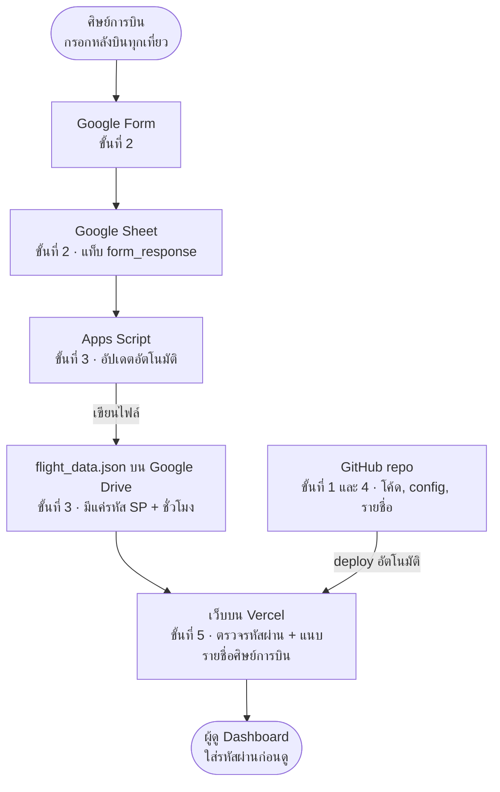

# Playbook: ติดตั้ง Flight Training Dashboard สำหรับรุ่นใหม่

> ไฟล์นี้คือคู่มือฉบับหลัก ถ้าแก้ระบบ ให้แก้คู่มือนี้ใน commit เดียวกัน
> ปรับปรุงล่าสุด: 18 ต.ค. 2026

## ภาพรวมและสิ่งที่ต้องเตรียม

คู่มือนี้พาตั้ง Dashboard ชั่วโมงบินของรุ่นคุณเองใน 6 ขั้น ใช้เวลาประมาณ 1–2 ชั่วโมง ทำผ่านเว็บทั้งหมด ไม่ต้องลงโปรแกรม และไม่มีค่าใช้จ่าย

เมื่อทำครบจะได้ 2 อย่าง:

- **Google Form** ให้ศิษย์การบินกรอกชั่วโมงบินหลังบินทุกเที่ยว
- **เว็บ Dashboard** ของรุ่น (เช่น `sp71-flight-log.vercel.app`) ล็อกด้วยรหัสผ่าน แสดงชั่วโมงบินรวม แยกช่วงประถม/มัธยม และประวัติการบินรายคน

ระบบของแต่ละรุ่นแยกจากกันทั้งหมด สิ่งที่คุณทำจะไม่กระทบข้อมูลหรือเว็บของรุ่นก่อน



Apps Script เขียนคำตอบจาก Form ลงไฟล์บน Drive เว็บบน Vercel อ่านไฟล์นั้น แล้วแนบรายชื่อให้เฉพาะคนที่ใส่รหัสผ่านถูก โค้ดของเว็บอยู่บน GitHub แก้เมื่อไรเว็บอัปเดตเอง

### บัญชีที่ต้องมี

| บัญชี | ใช้ทำอะไร | หมายเหตุ |
| --- | --- | --- |
| Google (Gmail) | Form, Sheet, Apps Script, ไฟล์ข้อมูลบน Drive | แนะนำให้สร้างบัญชีกลางของรุ่น จะได้ส่งต่อง่าย ควรเป็น Gmail ธรรมดา บัญชีองค์กรบางแห่งห้ามแชร์ไฟล์แบบสาธารณะ ซึ่งระบบต้องใช้ |
| GitHub | เก็บโค้ดของรุ่น | สมัครฟรีที่ [github.com](https://github.com) |
| Vercel | เปิดเว็บ Dashboard | สมัครด้วยปุ่ม Continue with GitHub ง่ายที่สุด ใช้แผน Hobby (ฟรี) |

### ลิงก์ที่ใช้

- Template ต้นฉบับ: [github.com/armorcoon/flight-log-template](https://github.com/armorcoon/flight-log-template)
- สร้างรหัสลับ (ใช้ในขั้นที่ 5): [generate-secret.vercel.app/32](https://generate-secret.vercel.app/32)

## ขั้นที่ 1: สร้าง repo ของรุ่นจาก Template

ขั้นนี้คัดลอกโค้ดต้นฉบับมาเป็นของรุ่นคุณ ใช้เวลาประมาณ 5 นาที Template ต้นฉบับจะไม่ถูกแก้

1. เข้าสู่ระบบ GitHub แล้วเปิด [github.com/armorcoon/flight-log-template](https://github.com/armorcoon/flight-log-template)
2. กดปุ่มสีเขียว **Use this template** → **Create a new repository**
3. กรอกข้อมูล:
   - **Owner:** บัญชีของคุณ
   - **Repository name:** ตัวพิมพ์เล็ก ไม่เว้นวรรค ตัวอย่าง `sp71-flight-log` (ถ้าใช้ตัวพิมพ์ใหญ่ Vercel จะแปลงชื่อเว็บให้ เช่น `SP71-flight-log` กลายเป็น `sp-71-flight-log`)
   - **เลือก Private** เท่านั้น เพราะจะมีรายชื่อและยศของศิษย์การบินอยู่ในนี้ ถ้าเผลอเลือก Public ให้แก้ที่ Settings → Danger Zone → Change visibility → Private ก่อนใส่รายชื่อ
4. กด **Create repository**

ผลลัพธ์: ได้ repo ใหม่ของรุ่นคุณ เช่น `github.com/<ชื่อบัญชี>/sp71-flight-log` จากนี้ไปทำงานใน repo นี้เท่านั้น

## ขั้นที่ 2: สร้าง Google Form และ Google Sheet

ชื่อคำถามใน Form ต้องตรงกับตารางด้านล่างทุกตัวอักษร เพราะสคริปต์หาคอลัมน์จากชื่อคำถาม ใช้เวลาประมาณ 20 นาที

> ทางลัด: ถ้ารุ่นก่อนแชร์ Form ให้ ให้เปิด Form นั้น → เมนู ⋮ → **ทำสำเนา** คำตอบเก่าไม่ติดมา แล้วข้ามไปข้อ 3 ได้เลย

| คำถาม (พิมพ์ให้ตรง) | ประเภทคำถามที่แนะนำ | บังคับตอบ |
| --- | --- | --- |
| `รหัส SP` | เลือกจากเมนูแบบเลื่อนลง (SP01, SP02, …) กันพิมพ์ผิด | ใช่ |
| `วันที่บิน` | วันที่ | ใช่ |
| `ประเภทอากาศยาน` | เลือกจากเมนูแบบเลื่อนลง (เช่น EN-480, B-206) | แนะนำ |
| `หมายเลขเครื่อง` | คำตอบสั้น | ไม่ |
| `Flight Hour (Dual)` | คำตอบสั้น (ตัวเลข) | ไม่ |
| `Flight Hour (Solo)` | คำตอบสั้น (ตัวเลข) | ไม่ |
| `Flight Hour (Night)` | คำตอบสั้น (ตัวเลข) | ไม่ |
| `Flight Hour (X country)` | คำตอบสั้น (ตัวเลข) | ไม่ |
| `Flight Hour (FLT Sim)` | คำตอบสั้น (ตัวเลข) | ไม่ |
| `Auto Rotation` | คำตอบสั้น (ตัวเลข) | ไม่ |

ช่องชั่วโมงให้กรอกเป็นทศนิยม เช่น 1 ชั่วโมง 30 นาที = `1.5` ไม่ใช่ `1:30` ตั้งได้ที่ ⋮ ของคำถาม → **การตรวจสอบคำตอบ** → ตัวเลข

1. เปิด [forms.google.com](https://forms.google.com) → สร้างฟอร์มเปล่า ตั้งชื่อเช่น "บันทึกชั่วโมงบิน SP71"
2. เพิ่มคำถามตามตารางด้านบน เพิ่มคำอธิบายใต้คำถามได้ แต่อย่าแก้ตัวคำถาม
3. ไปที่แท็บ **คำตอบ** → **ลิงก์กับชีต** → **สร้างสเปรดชีตใหม่**
4. ใน Sheet ที่เปิดขึ้นมา ดับเบิลคลิกชื่อแท็บด้านล่าง (เช่น "การตอบกลับแบบฟอร์ม 1") แล้วเปลี่ยนเป็น `form_response` **สำคัญ: สคริปต์หาแท็บด้วยชื่อนี้**
5. กลับไปที่ Form กด ดูตัวอย่าง (รูปตา) แล้วส่งคำตอบทดสอบ 1 รายการ ใช้รหัส SP01 และวันที่ใดก็ได้ (จะลบทิ้งในขั้นที่ 6)

## ขั้นที่ 3: ติดตั้ง Apps Script ในชีต

ขั้นนี้ให้ค่า `DRIVE_FILE_ID` ที่ต้องใช้ในขั้นที่ 5 ไม่ต้องแก้โค้ด แค่คัดลอกไปวางแล้วกดรัน ใช้เวลาประมาณ 10 นาที

1. ใน repo ของคุณบน GitHub เปิดไฟล์ [`google-apps-script/Code.gs`](google-apps-script/Code.gs) → กดปุ่ม **Copy raw file** (ไอคอนสี่เหลี่ยมซ้อนกัน มุมขวาบนของไฟล์)
2. ใน Google Sheet ของขั้นที่ 2 → เมนู **ส่วนขยาย** → **Apps Script**
3. ลบโค้ดเดิมในหน้าต่างทั้งหมด แล้ววางโค้ดที่คัดลอกมา → กด **บันทึก** (Ctrl+S) ตั้งชื่อโปรเจกต์เช่น `flight-log-sync`
4. ที่แถบด้านบน เลือกฟังก์ชัน `setup` → กด **เรียกใช้** (Run)
5. ครั้งแรก Google จะขอสิทธิ์:
   - กด **ตรวจสอบสิทธิ์** → เลือกบัญชีของรุ่น
   - เจอหน้า "Google ยังไม่ได้ยืนยันแอปนี้" → กด **ขั้นสูง** → **ไปที่ flight-log-sync (ไม่ปลอดภัย)** → **อนุญาต**
   - หน้าเตือนนี้เป็นเรื่องปกติ เพราะสคริปต์เป็นของคุณเอง ไม่ได้ผ่านการตรวจจาก Google
6. ดู **บันทึกการดำเนินการ** ด้านล่าง จะมีบรรทัด `DRIVE_FILE_ID = 1AbC...` → **คัดลอกค่านี้เก็บไว้** ใช้ในขั้นที่ 5
7. (แนะนำ) เลือกฟังก์ชัน `installAutoUpdate` → **เรียกใช้** ต่อจากนี้เว็บจะอัปเดตเองทุกครั้งที่มีคนส่ง Form และทุก 1 ชั่วโมง

`setup` สร้างไฟล์ `flight_data.json` ไว้ใน My Drive และเปิดแชร์แบบ "ทุกคนที่มีลิงก์ดูได้" เพราะเว็บต้องอ่านไฟล์นี้ได้ **อย่าลบหรือย้ายไฟล์นี้** ไฟล์มีแค่รหัส SP กับชั่วโมงบิน ไม่มีชื่อคน รัน `setup` ซ้ำได้ มันจะไม่สร้างไฟล์ใหม่ซ้อน

## ขั้นที่ 4: แก้ไฟล์ประจำรุ่น

แก้แค่ 2 ไฟล์ ทำบนหน้าเว็บ GitHub ได้เลย ใช้เวลาประมาณ 15 นาที

วิธีแก้ไฟล์บน GitHub: เปิดไฟล์ → กดรูปดินสอ (**Edit this file**) → แก้ → กด **Commit changes…** → เลือก **Commit directly to the main branch** → **Commit changes**

### 4.1 ไฟล์ `cohort.config.js`: ชื่อรุ่นและช่วงการฝึก

แก้เฉพาะค่าในเครื่องหมายคำพูด ตัวอย่างสำหรับรุ่น SP71 (วันที่สมมติ):

```js
export const COHORT = {
  name: "SP71",
  subtitle: "Flight Training Dashboard",
  pageTitle: "SP71 — ชั่วโมงบิน ฮ.",
  basic:    { label: "ประถม", sub: "Basic",    start: "2026-11-27", end: "2027-03-31" },
  advanced: { label: "มัธยม", sub: "Advanced", start: "2027-04-01", end: null },
};
```

- **วันที่ใช้ ค.ศ. รูปแบบ `ปปปป-ดด-วว`** เช่น 27 พ.ย. 2569 = `"2026-11-27"` ถ้าใส่ พ.ศ. เว็บจะไม่แสดงข้อมูล
- `end: null` = ช่วงนั้นยังไม่จบ ระบบนับวันถึงวันนี้ให้เอง
- เที่ยวบินตั้งแต่วัน `advanced.start` นับเป็นมัธยม ก่อนหน้านั้นนับเป็นประถม ถ้ายังไม่ถึงช่วงมัธยม ให้ใส่วันที่ตามแผนไปก่อน
- เที่ยวบินที่ลงวันก่อน `basic.start` หรือหลังวันนี้ จะถูกซ่อน กันกรณีพิมพ์วันที่ผิด เว็บจะขึ้นแถบสีเหลืองบอกว่าซ่อนไว้กี่รายการ
- ห้ามลบเครื่องหมายคำพูด `"` จุลภาค `,` หรือวงเล็บปีกกา `{ }` ถ้าหายไป เว็บจะ build ไม่ผ่าน

ด้านล่างของไฟล์มี `AIRCRAFT_ALIASES` ใช้รวมชื่อแบบอากาศยานที่สะกดต่างกัน เช่น `"BELL-206": "B-206"` ถ้าใช้เมนูแบบเลื่อนลงใน Form ตั้งแต่แรก มักไม่ต้องแก้ส่วนนี้

### 4.2 ไฟล์ `api/_sp-names.js`: รายชื่อศิษย์การบิน

ใส่ครบทุกคน บรรทัดละ 1 คน:

```js
export const SP_NAMES = {
  SP01: "ร.ต. ชื่อ สกุล",
  SP02: "จ.ส.อ. ชื่อ สกุล",
  SP03: "ส.อ. ชื่อ สกุล",
};
```

- รหัส SP ต้องตรงกับตัวเลือกใน Form ทุกตัวอักษร `SP01` กับ `SP1` ถือเป็นคนละรหัส
- อย่าย้ายรายชื่อไปไว้ใน `cohort.config.js` เพราะไฟล์นั้นส่งให้เบราว์เซอร์ทุกคนก่อนล็อกอิน ส่วนไฟล์นี้ส่งให้เฉพาะคนที่ใส่รหัสผ่านถูก

## ขั้นที่ 5: เปิดเว็บบน Vercel

Vercel เชื่อมกับ repo ของคุณ หลังจากนี้แก้ไฟล์บน GitHub เมื่อไร เว็บจะอัปเดตเองภายใน 1–2 นาที ใช้เวลาประมาณ 15 นาที

### 5.1 เตรียมค่า 3 ตัว

| ชื่อ (Key) | ค่า (Value) | ได้จาก |
| --- | --- | --- |
| `DASHBOARD_PASSWORD` | รหัสผ่านที่จะแจกให้คนในหน่วย | คิดเอง ใช้วลียาวๆ เช่น `heli-sp71-fly-safe-2027` อย่าใช้คำสั้น |
| `SESSION_SECRET` | ข้อความสุ่มยาวๆ | เปิด [generate-secret.vercel.app/32](https://generate-secret.vercel.app/32) แล้วคัดลอก ห้ามบอกใคร |
| `DRIVE_FILE_ID` | ID ของไฟล์ข้อมูล | Log ตอนรัน `setup` ในขั้นที่ 3 |

### 5.2 สร้างเว็บ

1. เปิด [vercel.com/signup](https://vercel.com/signup) → เลือก **Hobby** → **Continue with GitHub** (ถ้ามีบัญชีแล้วให้เข้าสู่ระบบ)
2. กด **Add New…** → **Project**
3. ในหัวข้อ **Import Git Repository** หา repo ของรุ่นคุณ → กด **Import**
   - ไม่เจอ repo: กด **Adjust GitHub App Permissions** แล้วให้สิทธิ์ Vercel เข้าถึง repo นั้น
4. **Project Name** จะกลายเป็นชื่อเว็บ เช่น `sp71-flight-log` → `sp71-flight-log.vercel.app`
5. **Framework Preset** ควรขึ้นเป็น **Vite** เอง ไม่ต้องแก้ Build Settings
6. เปิดหัวข้อ **Environment Variables** → เพิ่มทั้ง 3 ค่าจากตารางด้านบน ทีละคู่ Key/Value
7. กด **Deploy** → รอประมาณ 1 นาที จะเจอหน้า Congratulations และลิงก์เว็บ
8. (ไม่บังคับ) แท็บ **Analytics** → **Enable** เพื่อดูจำนวนคนเข้าเว็บ

**แก้ค่า Environment Variables ทีหลัง** (เช่น เปลี่ยนรหัสผ่าน): ไปที่ **Settings** → **Environment Variables** → แก้ค่า → แล้วต้อง **Redeploy** ทุกครั้ง (แท็บ **Deployments** → ⋯ ของรายการบนสุด → **Redeploy**) ไม่อย่างนั้นค่าใหม่ไม่มีผล

## ขั้นที่ 6: ทดสอบและแจกลิงก์

ติ๊กให้ครบทุกข้อก่อนแจกลิงก์ให้คนอื่น ถ้าข้อไหนไม่ผ่าน ดูหัวข้อ **แก้ปัญหาที่พบบ่อย**

- [ ] เปิดลิงก์เว็บ เจอหน้าเข้าสู่ระบบที่มีชื่อรุ่นของคุณ
- [ ] ใส่รหัสผิด ต้องขึ้น "รหัสผ่านไม่ถูกต้อง"
- [ ] ใส่รหัสถูก เข้าหน้า Dashboard และเห็นคำตอบทดสอบจากขั้นที่ 2 (อาจต้องรอสูงสุด 5 นาที) ถ้าหลักสูตรยังไม่เริ่ม คำตอบทดสอบจะไม่ขึ้นในตาราง แต่จะขึ้นแถบสีเหลือง "ซ่อนไว้ 1 รายการ" แทน แบบนี้ถือว่าผ่าน เพราะเว็บแสดงเฉพาะเที่ยวบินตั้งแต่วันเริ่มหลักสูตรถึงวันนี้
- [ ] ชื่อศิษย์การบินแสดงถูกต้อง ไม่ใช่แค่รหัส SP
- [ ] คลิกแถวในตาราง เปิดหน้าต่างประวัติการบินได้
- [ ] เปิดบนมือถือแล้วหน้าตาใช้ได้ปกติ
- [ ] ลบแถวคำตอบทดสอบออกจาก Sheet แล้วรัน `writeJsonToDrive` ใน Apps Script 1 ครั้ง

**อยากเห็นรายการทดสอบในตารางก่อนหลักสูตรเริ่ม:** แก้ `basic.start` ใน `cohort.config.js` ชั่วคราวเป็นวันในอดีต (เช่น ต้นเดือนนี้) และแก้วันที่ของคำตอบทดสอบใน Sheet ให้อยู่ระหว่างวันนั้นถึงวันนี้ แล้วรัน `writeJsonToDrive` ทดสอบเสร็จแล้ว**อย่าลืมเปลี่ยน `basic.start` กลับ**

### แจกให้คนในหน่วย

- **ลิงก์ Form** (ปุ่ม **ส่ง** มุมขวาบนของ Form → ไอคอนลิงก์) ให้ศิษย์การบินทุกคน
- **ลิงก์ Dashboard กับรหัสผ่าน** ให้คนที่ควรเห็นข้อมูล ส่งรหัสผ่านแยกจากลิงก์ อย่าโพสต์คู่กันในที่สาธารณะ
- **QR code:** ใน Chrome เปิดหน้า Form หรือ Dashboard → คลิกขวา → **สร้างคิวอาร์โค้ดสำหรับหน้านี้** → ดาวน์โหลด แล้วพิมพ์ติดที่ห้องเตรียมบิน

ผู้ใช้ที่ล็อกอินแล้วจะค้างอยู่ 7 วัน ถ้าต้องการให้**ทุกคนหลุดออกทันที** (เช่น รหัสหลุด) ให้เปลี่ยนทั้ง `DASHBOARD_PASSWORD` และ `SESSION_SECRET` แล้ว Redeploy เปลี่ยนแค่รหัสผ่านอย่างเดียว คนที่ล็อกอินอยู่แล้วยังเข้าได้จนครบ 7 วัน

## การใช้งานประจำวัน

ถ้ารัน `installAutoUpdate` ไว้แล้ว ผู้ดูแลแทบไม่ต้องทำอะไร ศิษย์การบินกรอก Form แล้วเว็บอัปเดตเองภายในประมาณ 5 นาที ป้าย "อัปเดตล่าสุด" มุมขวาบนบอกเวลาที่ข้อมูลถูกเขียนครั้งล่าสุด

| เมื่อต้องการ | ทำที่ไหน | วิธีทำ |
| --- | --- | --- |
| แก้เที่ยวบินที่กรอกผิด | Google Sheet | แก้ค่าในช่องตรงๆ เว็บอัปเดตในรอบชั่วโมงถัดไป หรือรัน `writeJsonToDrive` เองถ้าอยากเห็นทันที |
| ลบเที่ยวบินซ้ำ | Google Sheet | ลบทั้งแถว แล้วรัน `writeJsonToDrive` |
| อัปเดตเว็บทันที | Apps Script | เลือก `writeJsonToDrive` → เรียกใช้ |
| เพิ่มศิษย์การบิน หรือแก้ยศ/ชื่อ | GitHub | แก้ `api/_sp-names.js` และเพิ่มรหัส SP ในเมนูของ Form ด้วย |
| เพิ่มแบบอากาศยาน | Google Form | เพิ่มตัวเลือกในคำถาม `ประเภทอากาศยาน` เว็บแสดงแบบใหม่เอง |
| จบช่วงมัธยม หรือเลื่อนวันการฝึก | GitHub | แก้วันที่ใน `cohort.config.js` |
| เปลี่ยนรหัสผ่าน | Vercel | Settings → Environment Variables → แก้ → Redeploy |

ทุกครั้งที่แก้ไฟล์บน GitHub ให้เปิดเว็บดูอีกครั้งหลัง 2 นาที ถ้าเว็บไม่เปลี่ยน ให้ดูแท็บ Deployments ใน Vercel ว่ามีรายการสีแดง (Error) หรือไม่

**แต่งตั้งผู้ดูแล 2 คน** ที่เข้าถึงบัญชี Google, GitHub และ Vercel ของรุ่นได้ ถ้าคนหนึ่งไม่อยู่ อีกคนยังแก้ปัญหาได้ ใน GitHub เพิ่มคนที่สองได้ที่ Settings → Collaborators

## แก้ปัญหาที่พบบ่อย

ปัญหาส่วนใหญ่มาจาก 3 เรื่อง: ลืม Redeploy หลังตั้งค่า, ชื่อคำถามหรือชื่อแท็บไม่ตรง, และวันที่ใน config ผิด เมื่อไม่แน่ใจ ให้รัน `diagnose` ใน Apps Script ก่อน มันบอกว่าคอลัมน์ไหนไม่ตรง

| อาการ | สาเหตุ | วิธีแก้ |
| --- | --- | --- |
| หน้าเข้าสู่ระบบขึ้น "ยังไม่ได้ตั้งค่า DASHBOARD_PASSWORD และ SESSION_SECRET" | ยังไม่ได้ตั้งค่า หรือตั้งแล้วแต่ยังไม่ Redeploy | ตั้งค่าใน Vercel → Redeploy |
| ล็อกอินแล้วขึ้น "ยังไม่ได้ตั้งค่า DRIVE_FILE_ID บน Vercel" | ขาด `DRIVE_FILE_ID` | คัดลอกจาก Log ของ `setup` (รันซ้ำได้) → ใส่ใน Vercel → Redeploy |
| ล็อกอินแล้วขึ้น "drive returned non-JSON" หรือ "upstream fetch failed" | ID ผิด หรือไฟล์ไม่ได้แชร์แบบสาธารณะ | ตรวจ ID อีกครั้ง รัน `writeJsonToDrive` (มันเปิดแชร์ให้ใหม่) ถ้าใช้บัญชีองค์กรที่ห้ามแชร์สาธารณะ ให้ย้ายไปใช้ Gmail ธรรมดา |
| เว็บเป็น 0 SP หรือขึ้นแถบเหลือง "ซ่อนไว้ N รายการ" | วันที่บินอยู่ก่อน `basic.start` หรือเป็นวันในอนาคต (พิมพ์ปีผิด หรือหลักสูตรยังไม่เริ่ม) หรือใส่ปี พ.ศ. ใน config | ตรวจวันที่ใน `cohort.config.js` (ต้องเป็น ค.ศ.) และวันที่ใน Sheet → รัน `writeJsonToDrive` → รอ 5 นาที |
| Apps Script ขึ้น "หาคอลัมน์ไม่เจอ" | ชื่อคำถามใน Form ไม่ตรงกับตารางในขั้นที่ 2 | รัน `diagnose` ดูว่าคำไหนต่าง → แก้ชื่อคำถามใน Form ให้ตรง |
| Apps Script ขึ้น "ไม่พบชีต form_response" | ยังไม่ได้เปลี่ยนชื่อแท็บ | เปลี่ยนชื่อแท็บคำตอบเป็น `form_response` |
| Apps Script ขึ้น "ยังไม่ได้รัน setup()" | ข้ามข้อ 4 ของขั้นที่ 3 | รัน `setup` ก่อน 1 ครั้ง |
| ตารางแสดงรหัส SP แทนชื่อ | รหัสใน `api/_sp-names.js` ไม่ตรงกับ Form (เช่น `SP1` กับ `SP01`) | แก้ให้ตรงกัน |
| แบบอากาศยานเดียวกันขึ้น 2 ชื่อ | สะกดต่างกันใน Sheet | เพิ่มคู่ชื่อใน `AIRCRAFT_ALIASES` หรือแก้คำใน Sheet ให้เหมือนกัน |
| เที่ยวบินถูกนับผิดช่วง (ประถม/มัธยม) | `advanced.start` ไม่ตรงกับวันเริ่มมัธยมจริง | แก้วันที่ใน `cohort.config.js` |
| กรอก Form แล้วเว็บไม่อัปเดต | เว็บเก็บข้อมูลไว้ 5 นาที หรือไม่ได้ตั้งอัปเดตอัตโนมัติ | รอ 5 นาที ถ้ายังไม่มา ดูรูปนาฬิกา (ทริกเกอร์) ใน Apps Script ว่ามี 2 รายการ ไม่มีให้รัน `installAutoUpdate` |
| แก้ไฟล์บน GitHub แล้วเว็บไม่เปลี่ยน | build ไม่ผ่าน มักเพราะลบ `"` หรือ `,` หาย | เปิด Vercel → Deployments → รายการสีแดง → ดูบรรทัดที่ผิด → แก้บน GitHub ระหว่างนั้นเว็บเดิมยังใช้ได้ปกติ |

## เมื่อจบหลักสูตร: เก็บข้อมูลและส่งต่อ

เว็บของรุ่นคุณเปิดต่อได้เรื่อยๆ ไม่มีค่าใช้จ่าย ตราบใดที่ไม่ลบ Sheet, ไฟล์ `flight_data.json` และ project บน Vercel รุ่นถัดไปตั้งระบบของตัวเองใหม่จาก Template ไม่ใช้ของคุณ

### เก็บข้อมูลของรุ่น

- [ ] ใส่วันจบใน `advanced.end` ของ `cohort.config.js` จำนวนวันจะหยุดนับ
- [ ] ใน Apps Script รัน `removeAutoUpdate` เพื่อหยุดอัปเดตอัตโนมัติ
- [ ] ปิดรับคำตอบใน Form (แท็บคำตอบ → ปิดสวิตช์ รับคำตอบ)
- [ ] ดาวน์โหลด Sheet: ไฟล์ → ดาวน์โหลด → Microsoft Excel (.xlsx)
- [ ] ดาวน์โหลดไฟล์ `flight_data.json` จาก Google Drive
- [ ] เก็บไฟล์ทั้งสองไว้ในที่ปลอดภัยของหน่วย

### ส่งต่อให้รุ่นถัดไป

- [ ] ส่งลิงก์ Template ต้นฉบับ [github.com/armorcoon/flight-log-template](https://github.com/armorcoon/flight-log-template) ไม่ใช่ repo ของรุ่นคุณ เพราะ repo ของคุณมีรายชื่ออยู่
- [ ] ส่งคู่มือฉบับนี้ (ไฟล์ `PLAYBOOK.md` ใน Template) พร้อมจดสิ่งที่คุณเจอเพิ่มเติม
- [ ] (ไม่บังคับ) แชร์ Google Form ให้เป็นผู้ทำงานร่วมกัน รุ่นถัดไปจะทำสำเนาได้เลย
- [ ] อย่าให้ Sheet, รหัสผ่าน Vercel หรือบัญชีของรุ่นคุณ รุ่นถัดไปใช้บัญชีของตัวเอง

ถ้าคุณปรับปรุงระบบให้ดีขึ้น เช่น เพิ่มหน้าหรือแก้บั๊ก ให้แจ้งผู้ดูแล Template เพื่อนำกลับเข้าต้นฉบับ รุ่นต่อไปจะได้ใช้ด้วย
